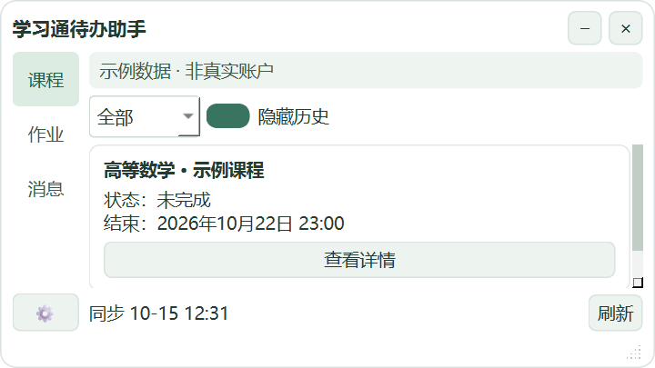
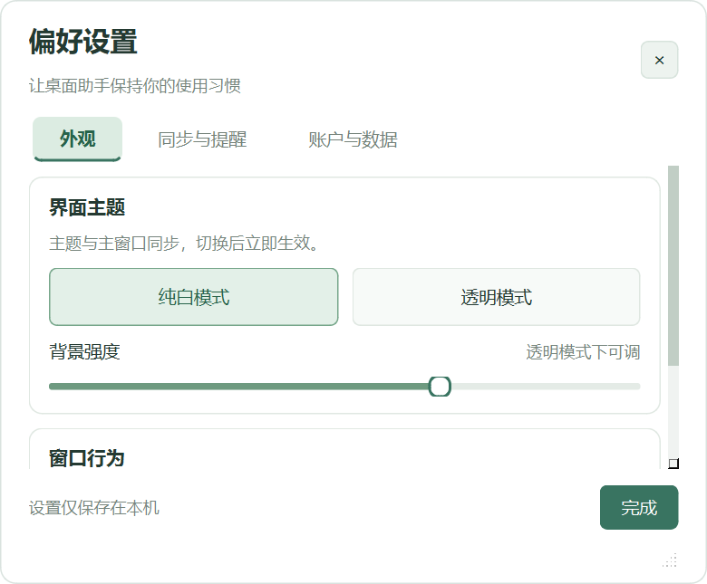

# 学习通待办助手

**把课程、作业和消息放进一个小巧的 Windows 桌面窗口。**

学习通待办助手是面向个人学习通（超星）账户的本地查询工具。它帮助你查看课程完成状态、整理未交作业和截止时间、阅读通知摘要，并在有可靠截止时间时发送桌面提醒。

日常使用不需要终端、Docker、云服务器或大模型 API。学习任务由使用者自行完成，程序不刷课、不答题、不提交作业、不自动确认通知。

> 当前版本：`v0.1.0`，Windows x64 便携预览版。使用社区项目研究的网页内部接口，功能可能随平台变化；不是学习通官方应用或官方公开 API 客户端。



## 功能亮点

| 页面 / 功能 | 说明 |
| --- | --- |
| 课程 | 只显示课程名称、结束时间和已完成/未完成/未知状态，支持隐藏历史课程 |
| 作业 | 汇总未交作业、提交状态、平台提供的截止时间；点击查看详情或打开原页面 |
| 消息 | 展示通知标题、来源、发送时间、摘要与未读状态；本地已处理与平台状态分开 |
| 小巧桌面窗口 | 默认480×270逻辑像素，横向窗口、左侧导航，支持缩放和位置记忆 |
| 两种主题 | 纯白与透明模式即时切换，透明强度可调；文字不随背景变淡 |
| 本地删除 | 课程/作业右键删除、撤销与恢复；不删除平台数据，刷新后不重新出现 |
| 后台与提醒 | 系统托盘、手动/定时同步、可靠截止时间的提前提醒、可选开机自启动 |
| 本地安全存储 | 会话与缓存通过Windows DPAPI保护；账户缓存隔离，不保存密码 |

## 下载与启动

1. 打开本仓库的 **Releases / 发行版**。
2. 下载 `XXTTodoAssistant-v0.1.0-windows-x64.zip`。
3. 完整解压，双击 `XXTTodoAssistant/XXTTodoAssistant.exe`。

**请保留整个解压后的文件夹，不能只移动 exe。** 程序已经包含Python、Qt与网页登录组件，不需要另外安装运行环境。

网页登录组件使便携包体积较大；GitHub源码下载不包含可执行程序，请到发行版获取Windows压缩包。

## 首次登录

1. 点击左下角 **⚙ 设置 → 账户与数据 → 网页登录 / 切换账户**。
2. 在学习通页面扫码或输入自己的账户密码，手动完成验证码和二次验证。
3. 网页登录完成后，点击 **我已登录，连接账户**。
4. 等待后台同步，在课程、作业和消息页面查看结果，并与学习通原页面核对。

不要在Issue、聊天或截图中发送密码、Cookie、二维码、验证码或账户数据库。网页登录在内存浏览器会话中进行，程序不保存密码。

## 日常使用

- **刷新**：立即同步；默认每30分钟同步，可在设置中修改。
- **查看详情**：后台读取内容，不执行作答页面脚本，也不填写或提交表单。
- **打开原页面**：使用系统浏览器，可能需要再次登录；访问可能产生平台访问或已读记录。
- **右键删除**：仅隐藏当前账户在本应用中的课程/作业。可撤销，或在设置的“本地删除记录”中恢复。已删除作业不再提醒。
- **关闭窗口**：可选择后台运行或退出；托盘菜单提供显示、同步和退出。
- **设置**：分为外观、同步与提醒、账户与数据三个页面。



## 日期、完成状态与可靠性

- 有完整日期和时刻时，按北京时间显示，并提供剩余时间。
- 只提供日期时标明具体时刻未知；只提供月日时刻时保留原文并标明年份未提供，不自行补年份或23:59。
- 课程结束时间和任务点截止时间含义不同。课程列表显示平台提供的课程结束时间，不将它冒充任务截止。
- 完成状态根据后台取得的可靠进度判断；没有可靠汇总、数据过期或无法判断时保持未知。
- 查询失败/结构不支持的课程和作业条目在列表中隐藏，缓存保留并继续尝试。**未显示不代表任务已完成。** 查询恢复成功后会重新出现。
- 仅有可靠完整截止时间的项目才发送绝对日期提前提醒；默认提前24小时和2小时。同一事件去重，截止变化后重新计算。
- 程序关闭或电脑休眠期间不承诺实时提醒，恢复后同步并检查遗漏；退出账户停止该账户提醒。

## 当前限制

1. 现有通知接口无法可靠区分“要求确认收到”和“已经确认收到”，明确显示确认状态不可获取；未读不等于未确认。
2. 部分作业只提供相对时间、无年份日期或没有截止字段；不能保证为所有作业提供完整日期或提前提醒。
3. 部分课程没有可靠汇总或任务截止字段；学期筛选字段未验证，历史筛选依据平台返回的课程状态。
4. 课程接口全量响应仍需对照平台抽查；作业和通知有分页安全上限，达到上限不会声称查询完整。
5. 透明模式为可调半透明背景回退方案，不是系统原生毛玻璃。
6. 已在Windows 11 x64构建并运行；尚未在第二台干净电脑和Windows 10完成验收。平台账户、学校和页面结构不同可能影响查询。

详细信息：[接口能力与来源](docs/接口研究.md) · [验证和限制](docs/验证与限制.md) · [隐私说明](docs/隐私说明.md)。

## 从源码运行与构建

建议使用Windows x64。当前构建环境为Python 3.14.7，依赖版本见 [requirements.txt](requirements.txt) 和 [requirements-lock.txt](requirements-lock.txt)。

```powershell
python -m venv .venv
.\.venv\Scripts\python.exe -m pip install -r requirements.txt
.\.venv\Scripts\python.exe main.py
```

重新打包可双击 `build.bat`，或运行：

```powershell
.\.venv\Scripts\python.exe -m unittest discover -s tests -v
.\.venv\Scripts\python.exe -m PyInstaller --noconfirm XXTTodoAssistant.spec
```

构建结果位于 `dist/XXTTodoAssistant/`。DPAPI相关测试需要正常Windows用户环境；受限沙箱可能缺少用户加密配置。

```text
assistant/
  api.py          接口查询、分页与同步
  domain.py       状态、时间与提醒规则
  storage.py      SQLite与DPAPI存储
  ui.py           主窗口、详情与托盘
  settings.py     设置页
  theme.py        两主题共享样式
  upstream.py     保留来源标注的MIT适配代码
assets/           只含示例数据的界面截图
docs/             接口、隐私和验证说明
tests/            必要回归测试
licenses/         第三方许可文本
```

## 引用与许可证

本项目自行编写代码采用 [MIT License](LICENSE)。复用代码保留原版权和许可证；第三方依赖遵循各自许可，见 [THIRD_PARTY_NOTICES.md](THIRD_PARTY_NOTICES.md) 和 [licenses/](licenses/)。

接口研究参考：[DanMo661/Xuexitong-mcp](https://github.com/DanMo661/Xuexitong-mcp)、[Zhanghuaimin-233/chaoxing-homework-checker](https://github.com/Zhanghuaimin-233/chaoxing-homework-checker)、[mshzy/study_assistant](https://github.com/mshzy/study_assistant)。这些是社区项目，不是官方公开接口文档。
